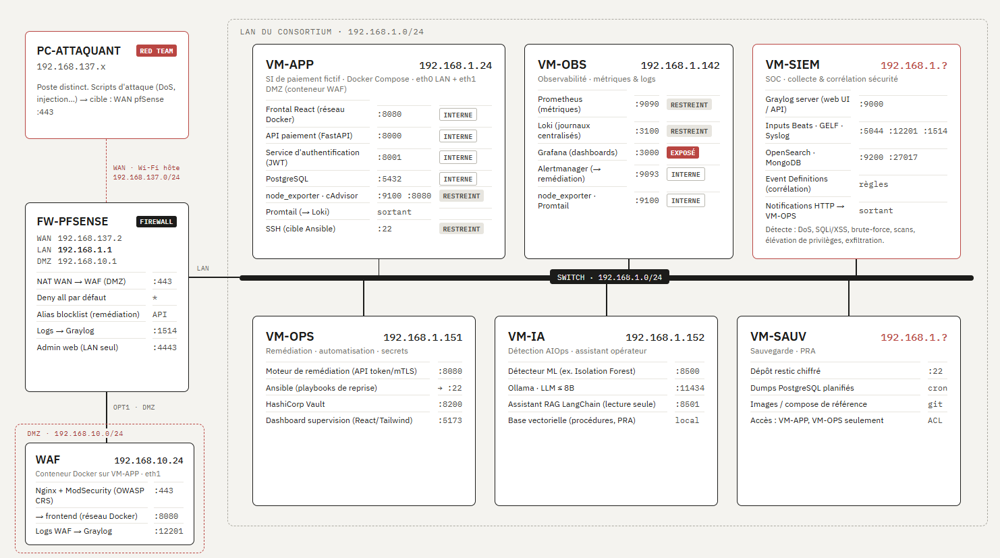

# PROJECT RESILIENCE-ALPHA — groupe M2-G4

Plateforme de paiement **fictive** à **reprise autonome** : elle subit une attaque, la détecte par ML, se répare seule, puis **prouve** la reprise en rejouant une vraie transaction. Workshop EPSI BAC+5 (4 jours), proof of concept, données 100 % fictives.

Dépôt public : <https://github.com/NMarcR42/WorkshopM2-G4>

## Architecture

Le déploiement cible est décrit par le schéma [`doc/archi_infra.png`](doc/archi_infra.png) (source de référence) : un réseau local de VM derrière un pare-feu pfSense, avec une DMZ pour le WAF.



Flux d'un paiement :

```
client / PC attaquant → pfSense (WAN :443, NAT) → WAF BunkerWeb (DMZ)
  → gateway nginx → frontend :8080 · api :8000 · auth :8001 → PostgreSQL :5432
```

| Machine | Rôle |
|---|---|
| `vm-app` | SI de paiement : WAF, gateway, frontend, api, auth, PostgreSQL |
| `vm-obs` | Observabilité : Prometheus, Loki, Grafana, Alertmanager |
| `vm-ops` | Remédiation (moteur + Ansible), secrets (Vault), dashboard de supervision |
| `vm-ia` | Détecteur ML, assistant RAG (Ollama) |
| `vm-siem` | Collecte et corrélation sécurité (Graylog) |
| `vm-sauv` | Sauvegardes chiffrées |

Le détail des déploiements (ports, réseaux, procédure) est dans les documents d'infra listés plus bas.

## Les cinq domaines

| Domaine | En une ligne | Dossier |
|---|---|---|
| **Dev** | Le SI de paiement : `api` (virements atomiques, idempotence), `auth` (JWT), `frontend` (login en 3 étapes — identifiant, **reconnaissance faciale**, mot de passe —, vitrine marchande fictive, historique), `canary` et transaction de contrôle (**la preuve métier**), `remediation` (reçoit les alertes, agit, ne conclut qu'avec la preuve), `supervision` (vue du jury). | [`dev/`](dev/README.md) |
| **IA** | `detector` (Isolation Forest, sans seuil codé en dur), serveur de **reconnaissance faciale** (caméra du poste, vérifié côté `auth`), `assistant` RAG local (Ollama, lecture seule). | [`ia/`](ia/README.md) |
| **Infra** | VM Proxmox, Docker Compose, Ansible, Prometheus / Loki / Grafana / Alertmanager, sauvegardes. | [`infra/`](infra/README.md) |
| **Cyber** | WAF BunkerWeb 1.6.16, attaque (saturation HTTP depuis un PC distinct), SIEM, secrets (SOPS + age). | [`cyber/`](cyber/README.md) |
| **Gouvernance** | Analyse de risques EBIOS RM, PCA/PRA, lecture NIS2/DORA. | voir l'index |

## La boucle de résilience

1. **Détecter** — le détecteur note chaque fenêtre de trafic ; Prometheus, Loki et le WAF fournissent les signaux, Alertmanager lève l'alerte.
2. **Décider** — le moteur `remediation` reçoit l'alerte (webhook Alertmanager), écarte les doublons et les faux positifs, et choisit une action dans une liste fermée : `restart`, `recreate`, `block_ip`, `isolate`, `restore_db`, `rollback_vm`.
3. **Agir** — l'action est exécutée par un playbook Ansible.
4. **Vérifier** — **vérification métier** : le `canary` rejoue une transaction complète (login, virement, contrôle de cohérence des soldes) et `POST /api/synthetic/transaction` la fait traverser auth, api et base. Un conteneur qui redémarre ne prouve rien : seul un paiement qui passe conclut l'incident. Sinon, escalade ; liste épuisée = incident visible pour un humain.

## Démarrage rapide

**Sur les VM** : la procédure complète est dans [`infra/proxmox-lab/README.md`](infra/proxmox-lab/README.md) et [`PROCEDURE-INFRA.md`](infra/proxmox-lab/docs/infra/PROCEDURE-INFRA.md).

**Mode dev et secours (mono-hôte, sans VM)** — Docker + Compose v2, Git, bash (Git Bash sous Windows) :

```bash
git clone https://github.com/NMarcR42/WorkshopM2-G4.git && cd WorkshopM2-G4
./scripts/init-local.sh                                    # crée .env et des secrets aléatoires dans .secrets/ (ignoré par git)
./scripts/compose.sh up -d --build db api auth frontend    # le parcours de paiement
./scripts/compose.sh ps                                    # état ; logs : ./scripts/compose.sh logs -f api
```

- `compose.sh` est `docker compose` avec les bons fichiers, choisis par `ROLES` et `REMEDIATION_MODE` dans `.env` (défaut : `ROLES=all`, `REMEDIATION_MODE=local`). Port 8000 pris : `API_PORT=18000`.
- Parcours à la main et test du site : [`doc/AUTH-FRONTEND.md`](doc/AUTH-FRONTEND.md). Test de bout en bout de l'authentification (avec et sans contrôle facial) : `./scripts/test-auth-e2e.sh`.
- Contrôle facial côté serveur : `FACE_ENFORCE` (défaut `false`, rien ne change), `FACE_SERVICE_URL`, secret `face_service_key`. Lancement du serveur de reconnaissance : [`ia/README-face.md`](ia/README-face.md).

## Structure du dépôt

```
dev/          api · auth · frontend · canary · remediation · supervision
ia/           detector · assistant (+ rag_docs) · face (reconnaissance faciale) · models · scripts
cyber/        documentation cyber : WAF, attaque, secrets
infra/        compose/ (mono-hôte) · ansible/ · monitoring/ · proxmox-lab/ (déploiement des VM, docs infra et gouvernance)
esp8266-led/  voyants LED du poste (PlatformIO)
doc/          documentation générale, schéma d'architecture
scripts/      compose.sh, init-local.sh, decrypt-secrets.sh, test-auth-e2e.sh
.github/      CI (ci.yml) et déploiement manuel (deploy.yml)
```

## Documentation

| Document | Rôle |
|---|---|
| [`doc/archi_infra.png`](doc/archi_infra.png) | Schéma de l'infrastructure (référence) |
| [`doc/ARCHITECTURE.md`](doc/ARCHITECTURE.md) | Services, contrats entre domaines, sécurité (voir la note ci-dessous) |
| [`doc/CONTRATS-INTERFACES.md`](doc/CONTRATS-INTERFACES.md) | Ce que l'infra attend de chaque domaine : ports, remédiation, métriques |
| [`doc/STACK.md`](doc/STACK.md) | Contraintes du sujet et rôle des outils |
| [`doc/AUTH-FRONTEND.md`](doc/AUTH-FRONTEND.md) | Parcours de paiement, login 3 étapes, reconnaissance faciale, comment tester |
| [`doc/CONCEPTS.md`](doc/CONCEPTS.md) | Glossaire |
| [`doc/ROADMAP.md`](doc/ROADMAP.md) | Pilotage et calendrier |
| [`doc/GITHUB.md`](doc/GITHUB.md) | Règles de branches / PR |
| [`dev/README.md`](dev/README.md), [`dev/api/README.md`](dev/api/README.md) | Services métier et API |
| [`ia/README.md`](ia/README.md), [`ia/README-face.md`](ia/README-face.md) | Détecteur, assistant, reconnaissance faciale |
| [`cyber/README.md`](cyber/README.md), [`infra/README.md`](infra/README.md) | Cyber et infra |
| [`PROCEDURE-INFRA.md`](infra/proxmox-lab/docs/infra/PROCEDURE-INFRA.md) | Installation et reconstruction de la plateforme |
| [`DEMO-JURY.md`](infra/proxmox-lab/docs/infra/DEMO-JURY.md) | Mode d'emploi de la démonstration |
| [`METRIQUES-POUR-IA.md`](infra/proxmox-lab/docs/infra/METRIQUES-POUR-IA.md) | Métriques à destination du détecteur |
| [`EBIOS-RM.md`](infra/proxmox-lab/docs/gouvernance/EBIOS-RM.md), [`PCA-PRA.md`](infra/proxmox-lab/docs/gouvernance/PCA-PRA.md) | Analyse de risques ; continuité et reprise |
| [`CLAUDE.md`](CLAUDE.md) | Consignes pour les sessions d'assistant IA |

> `doc/ARCHITECTURE.md` et `doc/STACK.md` décrivent encore en partie la première version mono-hôte (WAF nginx + ModSecurity, `docker-proxy`). En cas de divergence, le schéma `doc/archi_infra.png` et les documents d'infra font foi.

## Limites et suite

- Une seule attaque démontrée (saturation HTTP) ; injection et exfiltration relèveraient d'une réponse différente (confinement, forensique).
- Une instance par service, pas de haute disponibilité ; PostgreSQL est un conteneur unique, protégé par les sauvegardes et le PCA/PRA.
- Le login par visage n'est une vraie protection que si `FACE_ENFORCE=true` ; sans lui l'étape visage est de l'interface. Le plan B (mot de passe seul) se décide en repassant `FACE_ENFORCE=false`. Le serveur de reconnaissance dépend de la caméra du PC hôte.
- Le libellé d'un article n'est pas stocké par l'API : il est gardé dans le navigateur pour l'historique.
- Pas d'inscription : les comptes sont fixes (`dev/auth/app/users.json`).
- Suite : rollback réel par images versionnées, 2ᵉ attaque, inscription d'utilisateurs avec enregistrement du visage.
