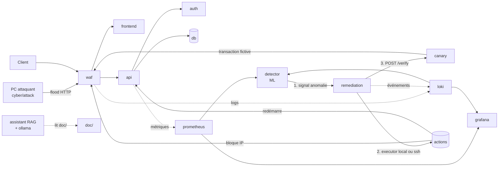

# Architecture

> Source de vérité de l'architecture, des contrats entre domaines et de la sécurité. Les autres documents y renvoient.

**Objectif** : prouver qu'une plateforme de paiement fictive survit à une attaque **sans humain** : attaque → détection ML → décision → remédiation → **vérification métier** (une transaction rejouée avec succès). Un conteneur qui redémarre ne prouve rien ; une intervention humaine pendant la démo vaut 0/5 sur l'axe le plus lourd. Toute décision de conception se juge à : « est-ce que cela fiabilise la boucle ? »

## Vue d'ensemble



## Services

| Service | Domaine | Rôle | Techno | Rôle machine |
|---|---|---|---|---|
| `waf` | CYBER | Filtre l'entrée, bloque les IP désignées par la remédiation | nginx + ModSecurity CRS | front |
| `frontend` | DEV | Vue paiement (client) et vue supervision (jury) | React + Tailwind | front |
| `api` | DEV | Virements fictifs ([détails](../dev/api/README.md)) | FastAPI | back |
| `auth` | DEV | Authentification, émission des JWT | FastAPI | back |
| `db` | DEV/INFRA | Comptes et transactions | PostgreSQL | back |
| `canary` | DEV | Rejoue une transaction toutes les 5 s (`payment_probe_success`) et expose `POST /verify` : **la preuve de reprise** | FastAPI | ops |
| `remediation` | DEV | Reçoit le signal, choisit l'action, l'exécute, vérifie via `canary`, journalise | FastAPI | ops |
| `detector` | IA | Score des fenêtres de trafic, envoie le signal d'anomalie | scikit-learn (Isolation Forest) | ops |
| `assistant`, `ollama` | IA | Aide les opérateurs (RAG sur `doc/`), lecture seule, ne pilote rien | LangChain + Ollama (≤ 8B) | ai |
| `prometheus`, `loki`, `grafana` | INFRA | Métriques, logs (= SIEM léger), tableaux de bord | — | ops |
| `promtail`, `cadvisor` | INFRA | Agents de collecte, un par machine | — | toutes |
| `docker-proxy` | CYBER | Autorise uniquement restart/stop/kill (mode `local`) | tecnativa/docker-socket-proxy | ops |

## La boucle, étape par étape

| # | Qui | Quoi |
|---|---|---|
| 1 | `cyber/attack` | Flood HTTP sur un endpoint coûteux depuis le PC attaquant. |
| 2 | `api`, `waf`, `cadvisor` | Métriques (req/s, latence, 5xx, CPU) et logs vers Prometheus/Loki. |
| 3 | `detector` | Toutes les 5 s : fenêtre de 10 s → score Isolation Forest. N fenêtres anormales de suite → signal. |
| 4 | `remediation` | Authentifie, dédoublonne, choisit l'action dans une liste fermée, l'exécute. |
| 5 | executor (`local` ou `ssh`) | Bloque l'IP source dans le WAF, redémarre l'API si elle n'est pas saine. |
| 6 | `canary` | `POST /verify` : transaction complète via le WAF + `GET /v1/ledger/check`. **C'est la preuve de reprise.** |
| 7 | `remediation` | Succès → `RESOLVED`. Échec → escalade (redémarrage, puis rollback). Tout est journalisé. |

L'état « avant / pendant / après » se lit dans Grafana grâce à la métrique `payment_probe_success`.

## Modes de déploiement

Même code, mêmes composes ; seul `.env` change.

| | **Mono-hôte** (défaut) | **Multi-machines** (cible, optionnel) |
|---|---|---|
| Usage | dev, répétition, **mode de secours** le jour J | déploiement final cloisonné, défendu devant le jury |
| Prérequis | Docker, rien d'autre | VM, réseau privé, utilisateur `resilience`, clé SSH, pare-feu |
| `.env` | `ROLES=all`, `REMEDIATION_MODE=local` | un `ROLES` par machine, `REMEDIATION_MODE=ssh` sur `ops`, adresses privées |
| Réseau entre services | DNS Docker natif (noms de services) | variables d'adresse (`API_URL`, `WAF_URL`, `LOKI_URL`) + `targets.yml` |
| Remédiation | `docker-proxy`, aucun réseau traversé | Ansible/SSH vers chaque machine |
| Démarrage | `./scripts/init-local.sh` puis `./scripts/compose.sh up -d --build` | `./scripts/decrypt-secrets.sh` (SOPS) puis idem sur chaque machine |

**La boucle complète doit tourner en mono-hôte** : c'est le mode de dev et de secours. Les réseaux Docker (`edge`, `app`, `obs`, `ctrl`, `ai`) y assurent déjà un cloisonnement logique.

### Multi-machines (à activer quand les VM sont prêtes)

| Machine (`ROLES`) | Compose | Services | Exposé |
|---|---|---|---|
| `front` | `infra/compose/front.yml` | waf, frontend | **WAF :8080 vers le réseau** (seul port public) |
| `back` | `infra/compose/back.yml` | api, auth, db | api/auth sur l'IP privée, filtrés au seul WAF ; db jamais |
| `ops` | `infra/compose/ops.yml` | remediation, canary, detector, prometheus, loki, grafana | Grafana en local/WireGuard ; Loki sur l'IP privée |
| `ai` (optionnelle) | `infra/compose/ai.yml` | ollama, assistant | assistant en local |
| toutes | `infra/compose/agents.yml` | promtail, cadvisor | cAdvisor sur l'IP privée |

Une machine de sauvegarde de la base est prévue dans la cible ; son rôle de compose reste à définir (voir PCA/PRA).

**Activer** : sur chaque machine, décommenter la section « MULTI-MACHINES » de `.env.example` dans `.env` (rôle, adresses, `*_BIND`) ; adapter `infra/monitoring/targets.yml` et `infra/ansible/inventory/lab.yml` ; créer l'utilisateur `resilience` et la clé `ansible_ssh_key` ; appliquer le pare-feu ci-dessous. Aucun fichier à réécrire.

Conséquences : plus de DNS Docker entre machines (adresses par variables, défauts = noms de services) ; un agent de collecte par nœud ; en mode `ssh`, la liste de blocage du WAF est écrite sur la machine `front` (`WAF_BLOCKLIST_SRC`), en mode `local` c'est un volume partagé.

## Interface (a) : signal d'anomalie, `detector` → `remediation`

`POST http://remediation:8000/v1/anomalies` — header `Authorization: Bearer <engine_token>` — réponse `202 {"incident_id": "..."}`.

```json
{
  "schema_version": "1.0",
  "anomaly_id": "uuid-v4",
  "detected_at": "2026-10-21T14:03:12Z",
  "detector": {"name": "isolation_forest", "model_version": "if-2026-10-21-1"},
  "score": 0.93,
  "consecutive_windows": 3,
  "target_service": "api",
  "window_s": 10,
  "features": {"rps": 840, "p95_ms": 2300, "err_5xx_ratio": 0.31, "cpu_pct": 96},
  "suspects": [{"kind": "ip", "value": "192.168.137.2", "share": 0.97}]
}
```

- `score` ∈ [0,1], plus haut = plus anormal. `anomaly_id` rend l'appel idempotent.
- `target_service` hors liste fermée (`api`, `auth`, `frontend`) → `422`.
- Le ML dit « anormal ou non » ; l'IP suspecte vient d'un top des sources dans Loki (pas du ML). À dire au jury.

## Interface (b) : `remediation` → exécution de l'action

`remediation` expose la même interface dans les deux modes : elle choisit une **action** dans une liste fermée ; seul l'*executor* change (`REMEDIATION_MODE`).

| Action | Paramètres | Mode `ssh` (Ansible) | Mode `local` (docker-proxy) |
|---|---|---|---|
| `block_source` | `block_ips`, `block_ttl_s` | `playbooks/block_source.yml` (groupe `waf`) | écrit la liste dans le volume `waf-blocklist`, puis restart du `waf` |
| `restart_service` | `target_service` | `playbooks/restart_service.yml` (groupe = nom du service) | `POST /containers/<nom>/restart` |
| `rollback_service` | `target_service` | `playbooks/rollback_service.yml` | restart seul (pas de retour de version en local : limite assumée) |

Commande du mode `ssh` :

```
ansible-playbook -i infra/ansible/inventory/${INVENTORY}.yml \
  infra/ansible/playbooks/<action>.yml \
  -e '{"incident_id":"<id>","target_service":"api","block_ips":["192.168.137.2"],"block_ttl_s":900}'
```

- Les groupes d'inventaire portent le nom des services (`waf`, `frontend`, `api`, `auth`, `db`) : voir `infra/ansible/inventory/` (`local.yml` = un seul hôte atteint par SSH, pour tester le mode `ssh` sans VM).
- Les commandes et appels sont construits par `remediation` ; rien du signal n'est passé au shell. Timeout 60 s. Actions idempotentes.
- Code retour OK = action appliquée, **pas** service rétabli (seul `/verify` le prouve).
- Chaque action écrit `/var/lib/resilience/incidents/<id>/<action>.json` (`changed`, `started_at`, `ended_at`) sur la machine `ops`.

## Réseaux

| Réseau | Contenu | Rôle |
|---|---|---|
| `edge` | waf, canary | entrée publique |
| `app` | waf, frontend, api, auth, db | métier ; db jamais publiée |
| `obs` | prometheus, loki, grafana, agents | observabilité / SIEM |
| `ctrl` | remediation, detector, canary, docker-proxy | contrôle ; **jamais exposé** |
| `ai` | ollama, assistant | assistant isolé, sans accès système |

## Routage de l'entrée (WAF)

Le navigateur est hors Docker : il ne connaît que le WAF (`:8080`) et appelle tout sur **la même origine** (pas de CORS, pas de nom de conteneur côté client). Le WAF route et **retire le préfixe** :

| Chemin reçu | Destination | Variable du WAF |
|---|---|---|
| `/api/…` | `api` (`/api/v1/accounts` → `/v1/accounts`) | `BACKEND` (= `API_URL`) |
| `/auth/…` | `auth` (`/auth/login` → `/login`) | `AUTH_URL` |
| tout le reste | `frontend` | `FRONTEND_URL` |

Le WAF pose `X-Forwarded-For` (IP réelle du client, lue par l'API et `auth`). Le front n'appelle jamais `remediation`, `detector` ni `assistant`. En dev sans WAF, le serveur Vite (`npm run dev`) applique ce même routage.

## Sécurité : pourquoi le cloisonnement

- **Rayon d'explosion** : si le WAF/front est compromis, il n'atteint ni la base ni les secrets du back ; si le back tombe, la supervision et la reprise (`ops`) survivent et peuvent agir.
- **Un seul port public** : `front:8080`. API, auth, base, Loki, Grafana ne sont joignables que depuis les machines autorisées.
- **Pare-feu** (multi-machines) : internet/PC attaquant → `front:8080` uniquement ; `front` → `back:8000` ; `ops` → `back`/`front` (SSH 22, métriques) ; tous → `ops:3100` (logs). Rien d'autre.
- **Secrets par machine** : chacune ne reçoit que les siens (le front n'a pas `db_password`).
- **Coût assumé** : plus de pièces à déployer et à faire communiquer (DNS, pare-feu, clés) ; c'est pourquoi le mono-hôte reste le mode de secours.

### Compromis sur les privilèges de la remédiation

C'est le composant le plus puissant : le compromettre, c'est pouvoir arrêter la plateforme.

| | Mode `local` (docker-proxy) | Mode `ssh` (Ansible) |
|---|---|---|
| Ce que le moteur peut faire | **restart/stop/kill uniquement** (testé : create, exec, delete, images, volumes, lecture de `/containers` = 403) | ce que permet le sudoers de l'utilisateur `resilience` sur chaque machine |
| Limite | n'importe quel conteneur de l'hôte peut être redémarré (le proxy ne filtre pas par nom) ; la liste d'actions est dans le code du moteur | une clé SSH détenue par le moteur ouvre **toutes** les machines concernées : plus large |
| Surface réseau | aucune (réseau `ctrl`) | SSH :22 ouvert de `ops` vers les autres machines |
| Durcissement | proxy sur `ctrl` seul, moteur non joignable par le trafic client | utilisateur sans shell libre, sudoers limité à `docker restart <service>` et à l'écriture de la liste de blocage, clé dédiée |
| Recommandation | défaut, suffisant pour la démo | à n'activer que si le sudoers est réellement restreint ; sinon le mode local est **plus sûr** malgré l'absence de cloisonnement |

Dans les deux modes : seul `detector` (token de service) peut appeler `remediation`, et chaque action est journalisée (audit dans Loki).

## Choix et limites assumés

- Python/FastAPI partout : une seule stack pour toute l'équipe.
- SOPS + age plutôt que Vault : pas de service à desceller le jour de la démo.
- SIEM = Loki + Grafana (alertes + journal d'audit de `remediation`), aucun composant en plus.
- Une seule attaque (saturation HTTP). Une 2ᵉ (injection, exfiltration) demanderait une réponse différente (confinement, forensique), pas une simple restauration.
- Une instance par service, pas de haute disponibilité ; la base est un conteneur sur la machine `back` (sauvegarde/restauration : voir PCA/PRA).
